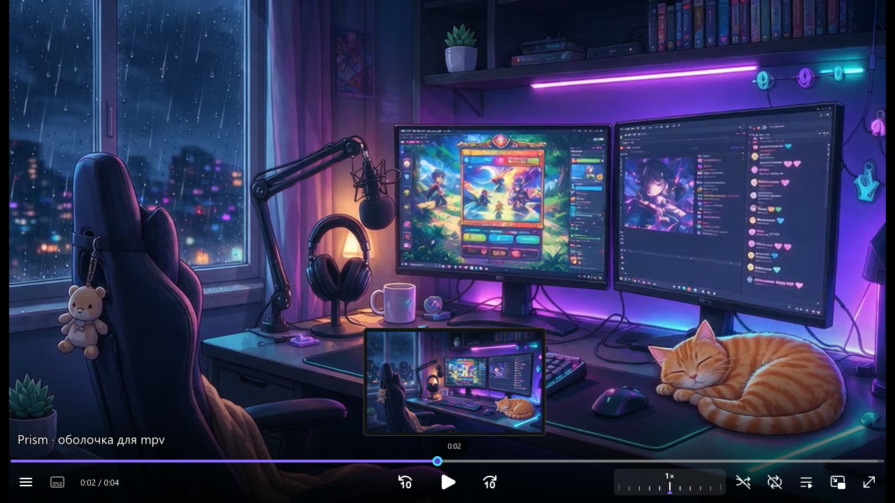
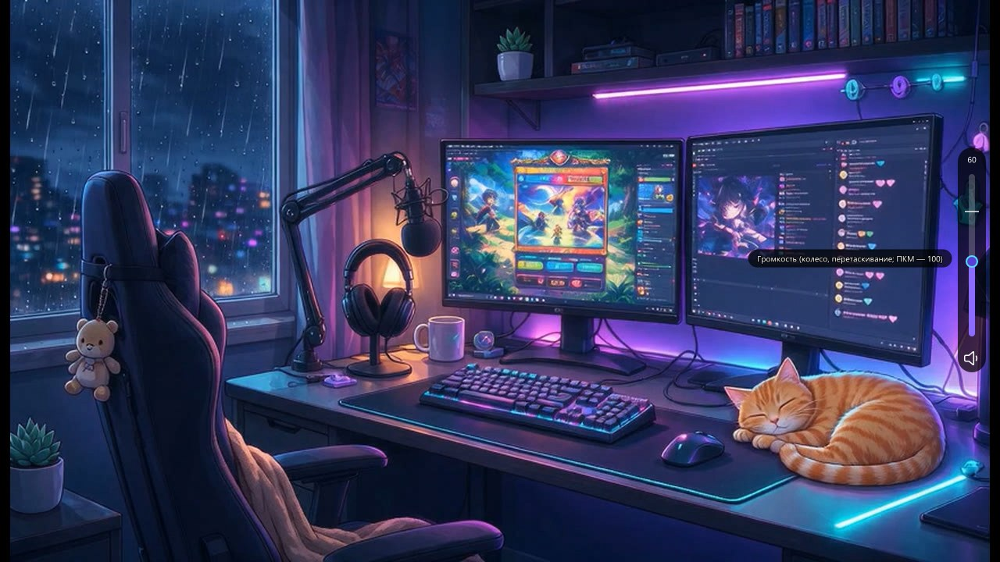
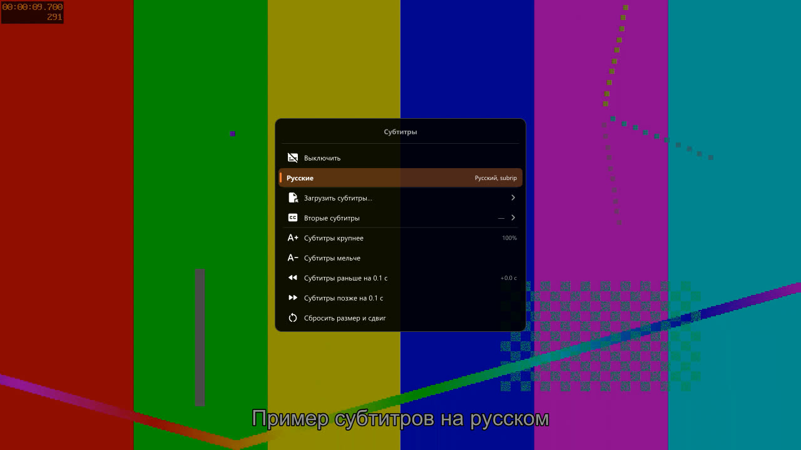
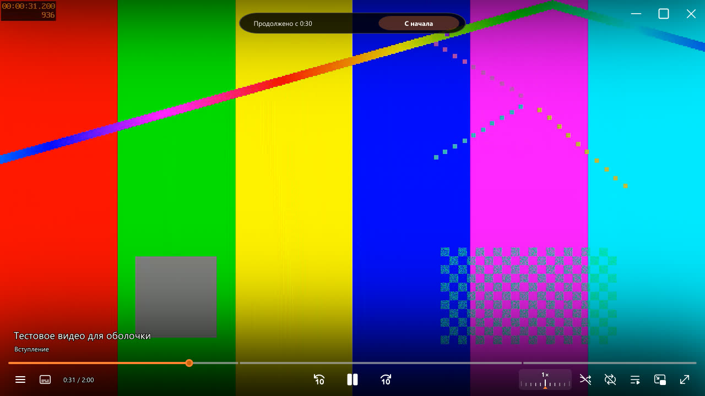
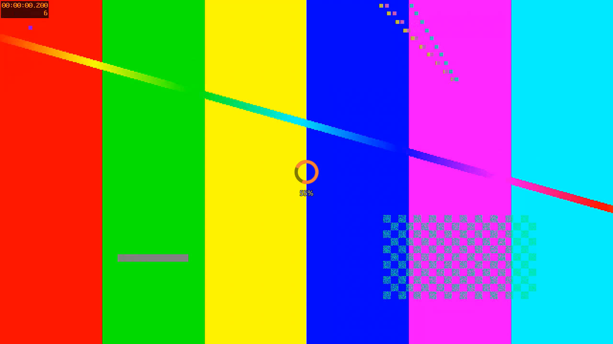
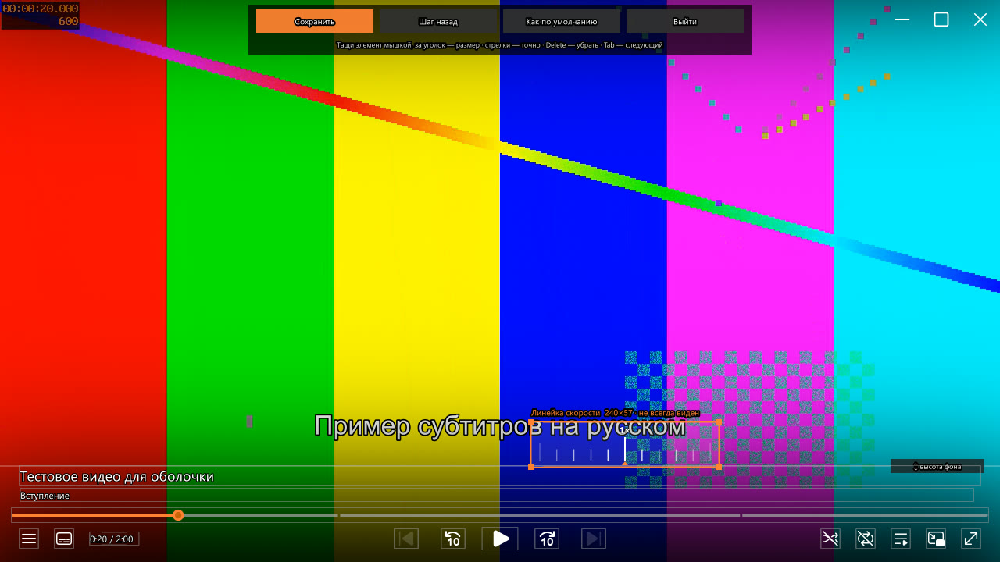
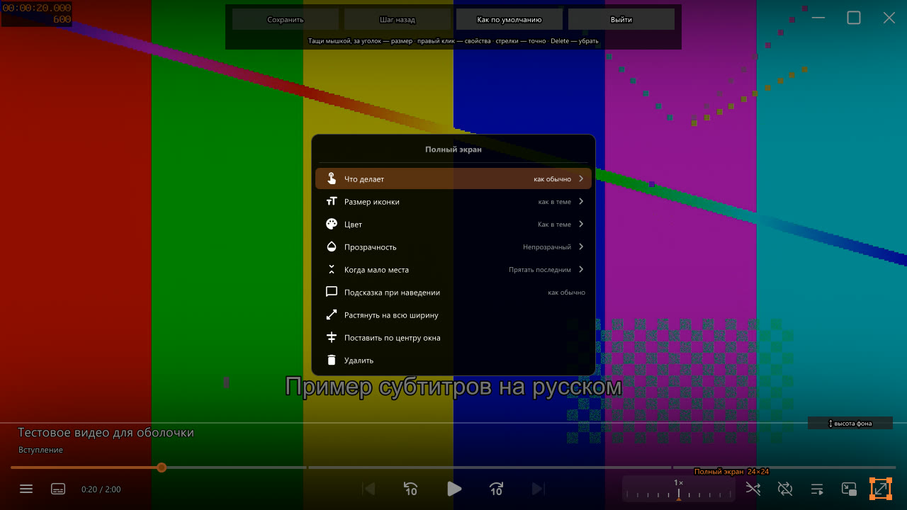
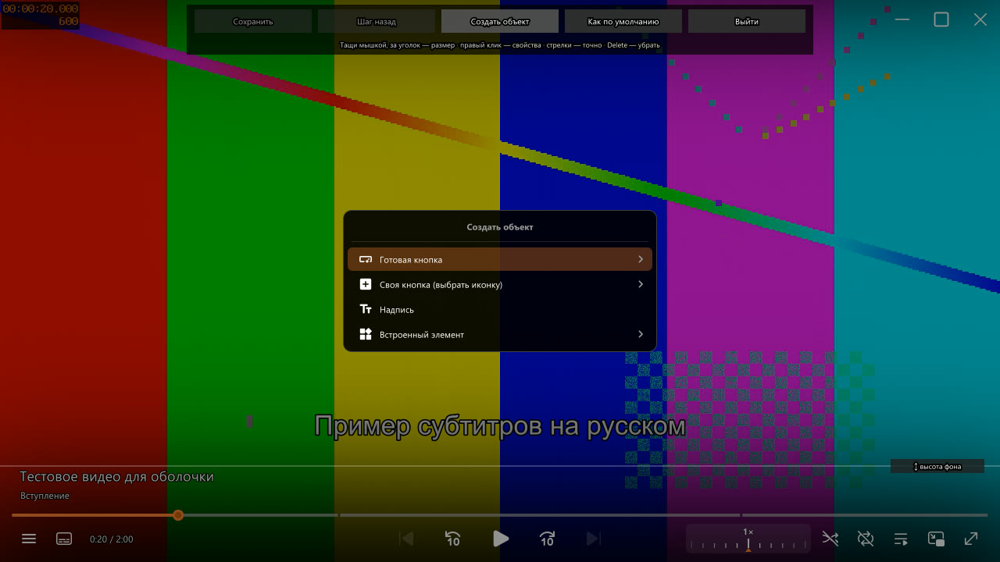
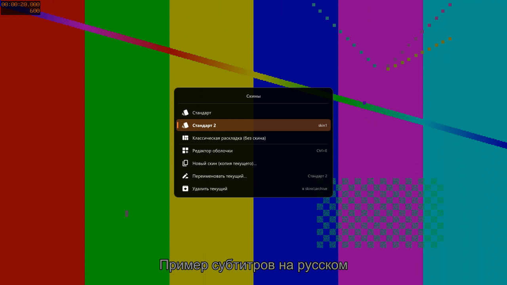

# mpv-hybrid-osc

Оболочка (панель управления) для видеоплеера [mpv](https://mpv.io): внешний вид
[ModernZ](https://github.com/Samillion/ModernZ) и удобные фишки [uosc](https://github.com/tomasklaen/uosc)
в одном скрипте, на русском языке. Панель можно **перестроить мышкой во встроенном редакторе**:
двигать и растягивать элементы, менять им цвет и действия, добавлять свои кнопки и держать
несколько скинов. Сделана для Windows, но скрипт кроссплатформенный.

## Что умеет

- **Панель как у ModernZ:** название файла и глава, полоса перемотки с главами и превью кадров
  ([thumbfast](https://github.com/po5/thumbfast)), под ней кнопки:
  меню, субтитры, время · назад 10 с, пауза, вперёд 10 с · линейка скорости, перемешать, повтор,
  плейлист, картинка в картинке, полный экран. Кнопки «предыдущее/следующее видео» появляются,
  когда в плейлисте больше одного файла. В узком окне менее важные кнопки прячутся сами.
- **Редактор оболочки** (`Ctrl+E`): всё на панели переставляется и настраивается мышкой,
  можно добавлять свои кнопки и надписи — [подробнее ниже](#редактор-оболочки).
- **Скины:** несколько вариантов панели, переключение в меню, выбор запоминается.
- **Громкость как в uosc:** вертикальный ползунок у края экрана — появляется при приближении мыши
  и при изменении громкости; колесо мыши над видео меняет громкость.
- **Линейка скорости как в uosc:** колесо, перетаскивание, правый клик — 1×.
- **Качество стримов и онлайн-видео** (меню → «Качество» или `Alt+Q`): Twitch/Kick-каналы
  открываются через [streamlink](https://streamlink.github.io/) (реклама Твича вырезается), качество
  меняется в том же окне; записи и ролики (Twitch VOD, YouTube через yt-dlp) перезапускаются
  в выбранном качестве с того же места.
- **Вспышка паузы** по центру экрана и **индикатор загрузки** с процентом.
- **Меню как в uosc** (правый клик): открыть файл, недавние, плейлист, главы, субтитры (размер,
  сдвиг, вторые субтитры, загрузка из файла), аудиодорожки, качество, скорость, соотношение сторон,
  повтор (в т.ч. отрезка A–B), аудиоустройство, скины, редактор оболочки, скриншот.
  Поиск — просто начни печатать.
- **«Продолжено с 12:34 · С начала»** — плашка при открытии недосмотренного видео.
- **Досмотренное не открывается на последнем кадре:** если закрыл видео в самом конце,
  в следующий раз оно начнётся с начала.
- **Двойной клик — полный экран.** Пауза по одиночному клику включается в настройках
  (`click_pause=yes`), перетаскивание окна при этом не мешает.
- **Картинка в картинке** — маленькое окно поверх всех в углу экрана.
- **SponsorBlock** — пропуск рекламы в YouTube-видео, отрезки подсвечены на полосе.
- **Темы:** orange, blue, purple, green, red, pink.
- Запоминает громкость и скорость между запусками.

| Громкость | Меню субтитров |
|---|---|
|  |  |
| **Продолжение просмотра** | **Загрузка** |
|  |  |

## Установка

Нужен mpv 0.40 или новее (проверено на 0.41). Необязательно:

- **Python** — для SponsorBlock;
- **[streamlink](https://streamlink.github.io/)** — чтобы смотреть эфиры Twitch/Kick и менять их качество;
- **[yt-dlp](https://github.com/yt-dlp/yt-dlp)** — для видео по ссылке (YouTube, записи Twitch и т.д.).

1. Скачай репозиторий (зелёная кнопка **Code → Download ZIP**) и распакуй.
2. Положи содержимое в папку настроек mpv:
   - Windows: `%APPDATA%\mpv\` или `portable_config\` рядом с `mpv.exe`;
   - Linux/macOS: `~/.config/mpv/`.

   Или запускай с отдельной папкой: `mpv --config-dir="путь\к\папке" видео.mkv`.
3. Если стоят другие оболочки (uosc, ModernZ и т.п.) — убери их скрипты из папки `scripts`,
   иначе будут две панели сразу. На Windows сборки mpv читают настройки ещё и из папки рядом
   с `mpv.exe` — проверь и её.

## Горячие клавиши

| Клавиша | Действие |
|---|---|
| Правый клик, `Menu` | главное меню |
| Двойной клик | полный экран |
| `Ctrl+O` | открыть файл |
| `Ctrl+H` | недавние файлы |
| `Alt+S`, `Alt+A`, `Alt+P`, `Alt+C` | субтитры, аудио, плейлист, главы |
| `Alt+D` | аудиоустройство |
| `Ctrl+P` | картинка в картинке |
| `Alt+Q` | качество стрима / онлайн-видео |
| `Ctrl+E` | редактор оболочки |
| `←` `→` / `↑` `↓` / колесо | перемотка 5 с / громкость |

Основные клавиши продублированы для русской раскладки. Все привязки — в `input.conf`.

## Редактор оболочки

Открывается по `Ctrl+E` или через меню → «Редактор оболочки». Видео встаёт на паузу,
вокруг элементов панели появляются рамки, сверху — кнопки «Сохранить», «Шаг назад»,
«Создать объект», «Как по умолчанию», «Выйти».

- **Тащи** элемент — переезжает, **за уголок** — меняется размер, ручка «высота фона» справа —
  высота тёмной подложки под панелью.
- Стрелки двигают выбранный элемент на 1 px (с Shift — на 10), `Tab` — следующий элемент,
  `Delete` — убрать, `Ctrl+Z` — шаг назад, `Ctrl+S` — сохранить. «Выйти» с несохранёнными
  изменениями сначала переспросит.
- **Правый клик по элементу — свойства:**
  - что делают левая и правая кнопка мыши и колесо — список действий на русском (пауза, перемотка,
    следующее видео, скриншот, громкость, скорость, меню, качество…) или своя команда mpv;
  - размер иконки или текста, цвет, прозрачность;
  - что прятать первым, когда окно узкое;
  - подсказка при наведении;
  - растянуть на всю ширину, поставить по центру, удалить.
- **«Создать объект»:**
  - готовая кнопка — скриншот, громче/тише, звук вкл/выкл, скорость 1.5×, ±30 с, главы, повтор,
    поверх окон, качество стрима, открыть файл, статистика, закрыть плеер…;
  - своя кнопка — иконка из списка, действие назначается в свойствах;
  - надпись — любой текст;
  - встроенный элемент — вернуть удалённый или добавить те, которых нет на панели
    (предыдущая/следующая глава, скриншот, поверх окон, аудиодорожки…).
- Положение элемента считается от левого края, центра или правого края окна — это выбирается
  само по тому, куда его поставил, поэтому панель правильно растягивается при любом размере окна.

| Свойства элемента | Создать объект |
|---|---|
|  |  |

## Скины

Меню → «Скины»: список скинов (у текущего отметка), «Классическая раскладка (без скина)»,
«Новый скин (копия текущего)», «Переименовать текущий», «Удалить текущий» — файл не стирается,
а переносится в `skins/archive`. Выбранный скин запоминается между запусками.

Скины — это файлы `skins/*.json` (их пишет редактор, руками править не нужно). Скин «Стандарт»
(`skins/standard.json`) повторяет классическую панель; если файл удалить, он берётся встроенный.

## Настройка

Всё в `script-opts/hybrid.conf` (с комментариями): раскладка, тема, шаг скорости и громкости,
где громкость (справа/слева), вид значка паузы, размер окна «картинки в картинке» и т.д.
Полный список параметров — в начале `scripts/hybrid/main.lua` (таблица `user_opts`).

- `layout=skin` — панель из скина (по умолчанию в этом конфиге), `skin=standard` — какой скин
  брать, пока в меню ничего не выбрано.
- `layout=default` — классическая раскладка: кнопки включаются и выключаются строками
  `menu_button`, `shuffle_button` и т.д., ширина линейки скорости — `speed_ruler_width`.

## Что где лежит

| Файл | Что делает |
|---|---|
| `scripts/hybrid/main.lua` | сама панель (на основе ModernZ), раскладки, громкость, линейка, PiP |
| `scripts/hybrid/menu.lua`, `menus.lua` | меню (отрисовка и пункты) |
| `scripts/hybrid/editor.lua` | редактор оболочки |
| `scripts/hybrid/skin.lua` | формат скинов: чтение, запись, стандартный скин |
| `skins/*.json` | скины |
| `scripts/stream-quality.lua` | выбор качества стримов и онлайн-видео |
| `scripts/forget-finished.lua` | досмотренное видео в следующий раз начинается сначала |
| `scripts/thumbfast.lua` | превью кадров над полосой перемотки |
| `scripts/sponsorblock*` | SponsorBlock |
| `script-opts/*.conf` | настройки скриптов |
| `input.conf`, `mpv.conf` | горячие клавиши и настройки mpv |

## Благодарности и лицензии

- Скрипт `scripts/hybrid` основан на [ModernZ](https://github.com/Samillion/ModernZ) (LGPL-2.1),
  который в свою очередь основан на `osc.lua` из mpv. Громкость, линейка скорости, вспышка паузы
  и поведение меню повторяют [uosc](https://github.com/tomasklaen/uosc) (LGPL-2.1).
  Редактор оболочки, скины, `stream-quality.lua` и `forget-finished.lua` написаны для этого проекта.
  Лицензия проекта — **LGPL-2.1** (файл `LICENSE`).
- `scripts/thumbfast.lua` — [thumbfast](https://github.com/po5/thumbfast), MPL-2.0.
- `scripts/sponsorblock*` — [mpv_sponsorblock](https://github.com/po5/mpv_sponsorblock), GPL-3.0
  (сообщения переведены на русский).
- `fonts/modernz-icons.ttf` — из ModernZ; `fonts/material-icons-round.otf` — Material Icons
  (Google, Apache-2.0) из uosc.
